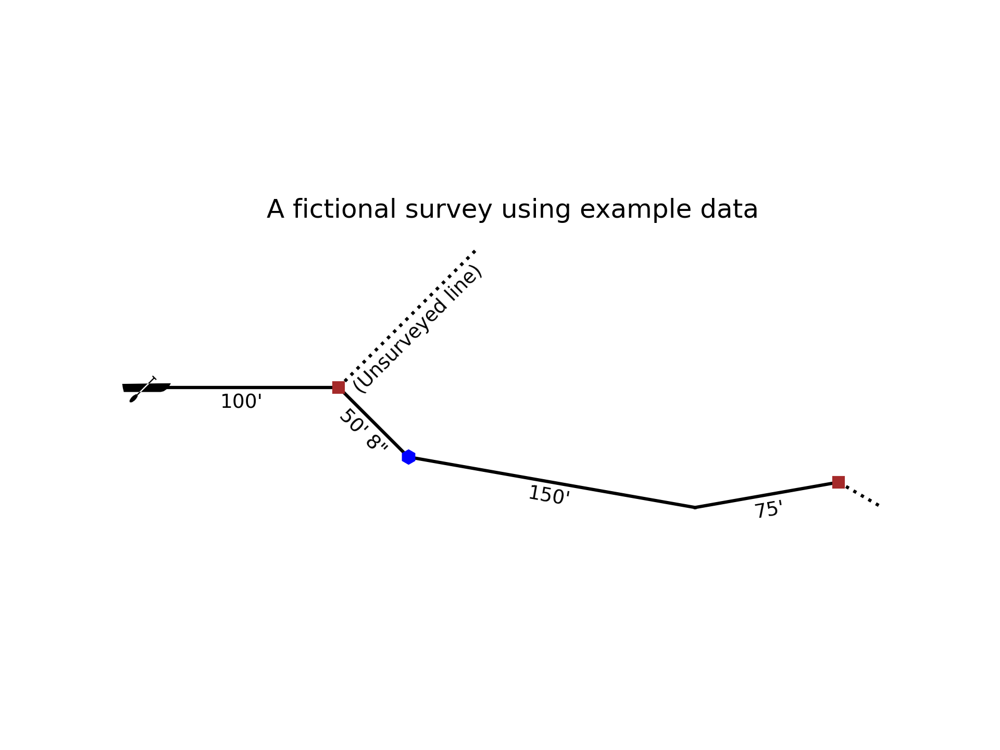

# Surveying the Bonnie Castle Dive Park

## Introduction

Thank you for volunteering to participate in the 2020 survey project of the Bonnie Castle Dive Park.  The survey data we are collecting is a valuable resource that helps us to guide future exporation and monitor the status of the current area.  This file is a quick guide to the data we are collecting in our surveys.

## How to collect data

This section describes the data that we collect.





### Surveyed and Unsurveyed line

Our map distinguishes between two types of line: surveyed and unsurveyed.

- **Surveyed line**: Most of the data you should be collection should be 
surveyed line.  We collect data about the length, compass heading, and endpoints (stake or tie-off) of each segment of surveyed line.  Length in feet is fine, although some divers like to report both feet and inches.

- **Unsurveyed line**: This should be reserved for unfinished areas.  Examples include: t-sections where some lines from the junction is not surveyed due to the divers collection data from the other lines, or the end of a completed section of surveyed line which needs to be finished later.  The example data and map shows both of these.

### Stakes, tie-offs, and other directional changes

The endpoints between surveye line can be one of three types:

- A **stake**

- A **tie-off**, for example a rock or a branch

- **Nothing**, for example when the line wraps around a rock face.

All three endpoints are shown in the example data and map.

## Example notebook entry

The following is what someone could write in her underwater notebook to collect data.  This serves as a example and a guide only.  You don't have to follow this format exactly!  Anything which is legible and contains the data we want is fine by us.

```
My boat (start)
100 ft, 90 deg
Stake, t-section, 3 way
Unsurveyed ??? ft 45 deg from stake
50 ft, 8in, 135 deg from stake
TieOff
150 ft, 100 deg
75 ft, 80 deg
Stake
Unsurveyed ??? ft, approx 120 deg

```

## Details

The survey data and code for generating the map is found in the online private repository at https://github.com/stpyang/survey.  Email stpyang@post.harvard.edu for access.

Thes survey map is generated using matplotlib and pythonv3.  The following in an example array which is saved in the `data.py` file:


```
ExampleData = (
    SaveLandmark(Landmark.MY_BOAT, icon_path='icons/rowboat.png'),
    SurveyedLine(length_ft=100, angle=90),
    Stake(),
    UnsurveyedLine(length_ft=100, angle=45, alt_text='(Unsurveyed line)'),
    Jump(length_ft=100, angle=225),
    SurveyedLine(length_ft=50, length_in=8, angle=135),
    TieOff(),
    SurveyedLine(length_ft=150, angle=100),
    SurveyedLine(length_ft=75, angle=80),
    Stake(),
    UnsurveyedLine(length_ft=25, angle=120, alt_text=''),
    )
```

A python function loops through each array of data and calls basic matplotlib functions to create the map and legend using some basic convenience functions in `base.py`.

To generate a new version of the map, make sure you have set up the packages installed in `requirements.txt` and simply run `python survey.py`.
